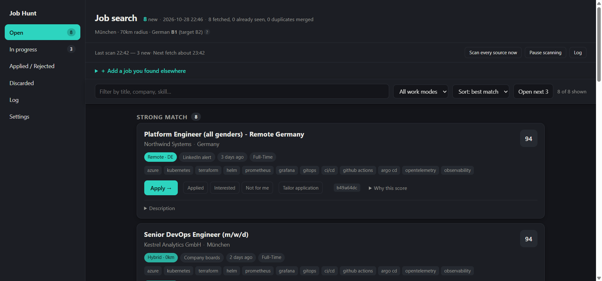
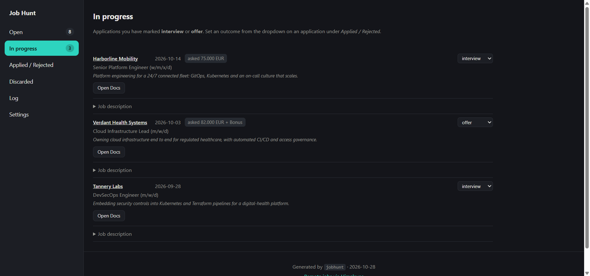
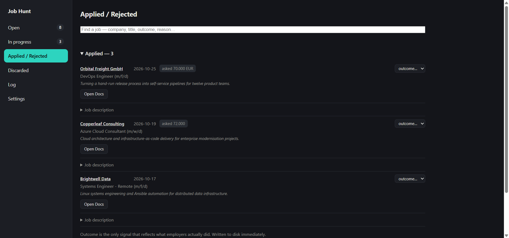
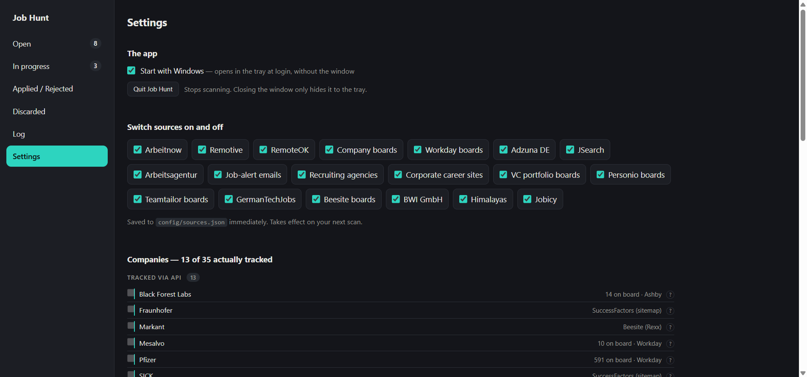

# jobsieve

A local, configurable job-search pipeline, tuned for the German job market.

It polls job APIs, company career boards, recruiting agencies and your own job-alert emails;
filters and scores every posting against a profile you control; **never shows you the same
job twice**; and writes an HTML report with Apply links and one-click status marking. For the
postings you choose, it can write a tailored CV and cover letter through Microsoft Word.

Nothing in the code assumes a field. What you are looking for — target titles, search terms, the
vocabulary that says a title belongs to your field, your skills — lives in your profile. Two
example profiles ship with it: a **full-stack web engineer** (`config/profile.example.json`, the
default template) and a **DevOps / SRE / cloud engineer** (`config/examples/devops.profile.json`).
What *is* built in is the German market: a German-language requirement gate, the federal
employment agency's API, German job-alert senders and German title compounds.

Rules decide the overwhelming majority of postings for free. Only the genuinely ambiguous
minority goes to a language model (Google Gemini) — and with no model configured the tool
still runs end to end on rules alone and says so in the report.

Repository: <https://github.com/jaisea/jobsieve>



<sub>All screenshots show invented demo data.</sub>

The requirements it is built to — what it finds, how it decides, what it remembers and what
it writes — are in [docs/requirements.html](docs/requirements.html). Most rules there carry
the incident that produced them, so they do not get removed by the next person who reads them.

---

## Prerequisites

**Required**

- **Node.js 22 or later** (built-in `fetch`, `node --test`). No build step, no bundler.
- **git**, to clone the repository.

**Optional — each unlocks one part, and everything else works without it**

| What | Unlocks | Without it |
|---|---|---|
| A **Google Gemini API key** (free tier is enough) | The model judges the postings the rules cannot settle; CV and letter writing | Rules verdicts, labelled as such; no application generator |
| An **Adzuna** developer key (free) | Adzuna DE — the main route to German listings, StepStone and XING among them | Source skipped |
| A **RapidAPI** key subscribed to **JSearch** (free tier) | LinkedIn / Indeed / Google Jobs listings | Source skipped |
| An **IMAP mailbox** with an app password | Your job-alert emails — the only route to StepStone, XING and LinkedIn alerts | Source skipped |
| **Electron** (installed by `npm install` as a dev dependency) | The background app: scheduled scans, tray icon, taskbar badge | Run searches by hand |
| **Windows + Microsoft Word** | The application generator (Word is driven through PowerShell/COM); the background app's taskbar badge, toasts and shortcuts | Searching, the report and the server run anywhere Node does |

Two runtime dependencies, `imapflow` and `mailparser`, are both for reading alert emails.
Electron needs Node **22.12** or newer to download its binary; on an older Node `npm install`
completes without it — upgrade Node, or run
`node --experimental-require-module node_modules/electron/install.js` once.

---

## Setup, step by step

### 1. Clone and install

```bash
git clone https://github.com/jaisea/jobsieve.git
cd jobsieve
npm install
```

### 2. Create your profile

Pick the example closest to what you are looking for and copy it to `config/profile.json`:

```bash
cp config/profile.example.json config/profile.json            # full-stack web engineer
# or
cp config/examples/devops.profile.json config/profile.json    # DevOps / SRE / cloud engineer
```

`config/profile.json` is gitignored — it holds who you are and what you want. Every gate and
weight is read from it at runtime. Edit at least:

- `currentTitle`, `yearsExperience`, `field` — told to the model as who you are.
- `location` — home city, `lat`/`lon`, `radiusKm`. The examples use München.
- `languages.germanLevel` — your CEFR level; drives the German gate.
- `targetTitles` — `strong` (what you want), `good` (near-identical roles), `exclude`.
- `searchQueries` — what the keyword APIs are asked for (this list costs API quota).
- `relevance` — the title vocabulary of your field (see [Relevance vocabulary](#3-relevance-vocabulary--profilerelevance)).
- `skills` — what you work with, for scoring.

See [Configuration](#configuration) for every key. To try a second configuration without
touching `config/profile.json`, point `JOBHUNT_PROFILE` at another file
(`JOBHUNT_PROFILE=config/examples/devops.profile.json npm run dry`).

### 3. Create the `.env` file

```bash
cp .env.example .env
```

`.env` holds credentials and is gitignored. **Every key is optional** — a source or provider
whose key is missing skips itself with a warning, so a half-filled file still runs end to end.
What each variable does:

| Variable | Default | What it is |
|---|---|---|
| `LLM_PROVIDERS` | `gemini` | The provider list. Gemini is the only provider; leave it as is |
| `GEMINI_ENABLED` | `true` | `false` parks the model without deleting the key; search falls back to rules verdicts and says so |
| `GEMINI_API_KEY_JUDGE` | — | The key used to judge uncertain postings. Best from a Google project **without** billing (the free tier) |
| `GEMINI_MODEL_JUDGE` | `gemini-flash-lite-latest` | The judging model. A `-lite` model has a far larger free daily allowance. Left blank, a 404 makes the tool ask the API which models your key can use |
| `GEMINI_MAX_CONCURRENCY_JUDGE` | `1` | Parallel judging calls. Leave at 1 on the free tier — more only produces rate limits |
| `GEMINI_API_KEY_APPLY` | — | Optional key for writing CVs and letters, typically from a **billed** project. Unset: the judging key is used |
| `GEMINI_MODEL_APPLY` | — | Optional, better model for writing (e.g. `gemini-3.7-flash`). Unset: the judging model |
| `GEMINI_MAX_CONCURRENCY_APPLY` | — | Not read: writing makes its calls one after another. Listed in the template for completeness |
| `GEMINI_JUDGE_OVERFLOW_TO_APPLY` | off | `true` lets judging continue on the billed `_APPLY` key once the free **daily** quota is spent. Costs money; see [When the model is rate limited](#when-the-model-is-rate-limited) |
| `IMAP_HOST` | — | Your mail server, e.g. `imap.gmail.com`, `outlook.office365.com`, `imap.gmx.net` |
| `IMAP_PORT` | `993` | IMAP over TLS |
| `IMAP_USER` | — | Your mailbox login, usually the address |
| `IMAP_PASSWORD` | — | An **app password**, never your normal login password |
| `IMAP_FOLDER` | `INBOX` | The folder (Gmail: the label) your job alerts are filed in, e.g. `jobalerts` |
| `IMAP_SINCE_DAYS` | `7` | How far back to read the first time, and after the parser, rules or profile change. Every other scan reads only new mail |
| `ADZUNA_APP_ID`, `ADZUNA_APP_KEY` | — | Adzuna developer credentials |
| `RAPIDAPI_KEY` | — | Your RapidAPI key, for JSearch |

Not in the template but read if set: `IMAP_TLS` (`false` for a plain-text IMAP server), and the
switches used by tests and trial runs — `JOBHUNT_PROFILE` (another profile file),
`JOBHUNT_DATA_DIR` / `JOBHUNT_REPORTS_DIR` (move `data/` and `reports/`), `JOBHUNT_LOG_FILE`,
`JOBHUNT_NO_LOGFILE`, `JOBHUNT_CONNECTIVITY_PROBES` and `GEMINI_API_BASE`.

**Editing `.env`:** a `#` preceded by whitespace starts a comment; quoted values are taken whole
(`IMAP_PASSWORD="p#ss w#rd"`), and `a#b` with no space is one value.

### 4. Get the API keys

#### Gemini (Google AI Studio)

1. Go to [aistudio.google.com/apikey](https://aistudio.google.com/apikey) and sign in with a
   Google account.
2. Press **Create API key**. Choose (or let it create) a Google Cloud project. A project with
   **no billing account** stays on the free tier — that is what you want for judging.
3. Copy the key into `.env` as `GEMINI_API_KEY_JUDGE`. Keep `GEMINI_MODEL_JUDGE` on a `-lite`
   model unless you have a reason: the newest non-lite models allow only a handful of free
   requests a day, which one scan can exhaust.
4. *Optional — a writing key.* Billing and rate limits belong to the **project**, not to the key,
   so two keys in one project share one quota and one bill. If you want the better model for
   CVs and letters on a paid plan, create a key in a **second** project with billing enabled and
   put it in `GEMINI_API_KEY_APPLY` (and the model in `GEMINI_MODEL_APPLY`).
5. *Optional — overflow.* `GEMINI_JUDGE_OVERFLOW_TO_APPLY=true` (needs the apply key) keeps
   judging on the billed project when the free project's daily quota is spent, with the cheap
   judging model. Off by default because it is the only thing in the tool that spends money;
   every billed call is counted and shown.

The free daily quota resets at midnight Pacific time (09:00 in Germany).

#### Adzuna

1. Register at [developer.adzuna.com](https://developer.adzuna.com/) (*Sign up*), and confirm the
   email.
2. Open the developer dashboard. It shows your **Application ID** and **Application Key**.
3. Put them in `.env` as `ADZUNA_APP_ID` and `ADZUNA_APP_KEY`.

The free tier is about 250 calls a **day**. One run costs queries × `maxPages` (3) × 2 modes
(local and nationwide remote), so 6–7 queries is about 40 calls. `config/sources.json` caps it
with `"quota": { "perDay": 250, "maxRunsPerDay": 5, "skipOnDryRun": false }`; a daily cap refills
overnight, so a dry run still asks Adzuna.

#### JSearch via RapidAPI

1. Create an account at [rapidapi.com](https://rapidapi.com/).
2. Open the JSearch API page
   ([rapidapi.com/letscrape-6bRBa3QguO5/api/jsearch](https://rapidapi.com/letscrape-6bRBa3QguO5/api/jsearch))
   and go to its **Pricing** tab. **Subscribe** to the free plan (about 200 requests a
   **month**). Note the day of the month you subscribed — RapidAPI meters from that day.
3. Open the API's **Playground / Endpoints** tab and select the search endpoint. The code snippet
   on the right shows two headers: copy the value of **`X-RapidAPI-Key`** into `.env` as
   `RAPIDAPI_KEY`.
4. In the same snippet, check the **`X-RapidAPI-Host`** value and the path after the host in the
   request URL. They must match `host` and `path` in the `jsearch` block of `config/sources.json`
   (shipped as `jsearch.p.rapidapi.com` and `/search-v2`). Several similarly named job APIs live
   under different hosts: a 404 means the host or path does not match the API you subscribed to,
   and a 403 means the key is valid but not subscribed (subscribe on the Pricing tab).
5. Set the quota block in the same `jsearch` entry to your subscription:

   ```json
   "quota": {
     "perMonth": 200,
     "cycleResetsOnDay": 14,
     "maxRunsPerDay": 1,
     "maxQueries": 4
   }
   ```

   `cycleResetsOnDay` is **your** subscription day. If you used the API before the tool started
   counting, record it as `"assumeUsed": { "cycle": "YYYY-MM-DD", "calls": N }` — pinned to that
   cycle's start date, so it stops applying by itself next month; remove any `assumeUsed` that is
   not yours. `src/quota.js` paces what is left over the days left in the cycle, refuses a second
   run the same day, and never spends anything on a dry run.

JSearch needs an explicit `country` (`"de"` in `sources.json`); without it the API defaults to the
US and returns nothing relevant.

#### IMAP — your job-alert emails

LinkedIn, StepStone and XING have no usable public API and block scraping, so they are reached
through the alert emails they send you.

1. **Create the alerts.** On each site, save a search for the roles you want and turn on a daily
   email alert.
2. **File them in one folder.** Create a mail filter that moves (or labels) alerts from those
   senders into one folder — e.g. a Gmail label `jobalerts`. Set `IMAP_FOLDER` to it
   (`jobalerts`, or `INBOX/jobalerts` on some servers). Mail not in that folder is never read.
3. **Create an app password**, never your normal password:
   - **Gmail:** turn on 2-Step Verification, then create one at
     [myaccount.google.com/apppasswords](https://myaccount.google.com/apppasswords). Host
     `imap.gmail.com`. Make sure IMAP access is on in Gmail's *Forwarding and POP/IMAP* settings.
   - **Outlook / Microsoft 365:** account.microsoft.com → *Security* → app passwords (needs
     two-step verification). Host `outlook.office365.com`.
   - **GMX:** *Settings → POP3/IMAP*, enable IMAP access. Host `imap.gmx.net`.
4. Fill in `IMAP_HOST`, `IMAP_PORT` (993), `IMAP_USER`, `IMAP_PASSWORD` and `IMAP_FOLDER`.

The tool only reads; it never marks mail read or changes anything in the mailbox.

### 5. Check the keys

```bash
npm run keys
```

One live call per API key and per AI provider, each reported as working or not, with the reason.

### Steps 6 and 7: pick ONE way to run it

Steps 6 and 7 are **alternatives, not a sequence**. Both run the same pipeline over the same data;
they differ only in who starts the scans and where you read the results.

| If you prefer… | Do | Skip |
|---|---|---|
| **the command line** — you start each scan yourself and open the report in your browser | step 6 | step 7 |
| **the UI** — a tray app that scans on its own and shows the report in its own window | step 7 | step 6 |

You can switch later or use both (see [The command line beside the app](#the-command-line-beside-the-app)).

### 6. Command line (skip this if you use the app in step 7)

```bash
npm run dry       # the whole pipeline with per-phase counts, writing nothing
npm run search    # a real scan: fetch, judge, remember, write reports/latest.html
npm run serve     # open the report with working buttons on http://127.0.0.1:8787
```

A full scan takes several minutes and spends API quota. Run `npm run search` a second time: it
should report **0 new jobs** — that is the memory working. From then on `npm run daily` does
search-then-serve in one command.

### 7. The background app — the UI (skip this if you use the command line in step 6)

```bash
npm run tray            # start it
npm run tray:shortcut   # a Desktop and Start-menu shortcut for it
```

It scans on a schedule, shows the number of open jobs in the tray and on the taskbar, and opens
the report in its own window — no terminal needed after this. **Scan now**, **Pause** and
**Start with Windows** are in the tray menu and on the app's Settings page (starting with Windows
is off until you tick it). See [The background app](#the-background-app).


### 8. The application generator (optional, Windows + Word)

You also need:

- `config/master.json` — your career data in detail: identity, positioning, voice, the
  technologies you have used (`facts.technologies`), which employers' bullets may be tailored
  (`tailoring.employers`), an optional `angle` (how to pitch yourself, told to the writing model),
  and `output.applicationsDir`, the absolute path where application folders are written.
  Gitignored.
- `templates/resume.docx` and `templates/cover-letter.docx` — your real Word CV and letter.
  The generator edits them in place, so layout and formatting survive. Gitignored.

---

## How it works

```
sources ──► normalize ──► 1.1 title gates ──► 1.2 is it still open? ──► 2.1 full-advert gates ──► 2.2 LLM ──► memory ──► report
            (fingerprint)   (no network)        (fetch the advert)        (rules, no model)          (only the
                                                                                                     uncertain)
```

1. **Fetch.** Every enabled source is fetched — several at once — and each source's postings are
   processed the moment they arrive.
2. **Phase 1.1 — the title alone.** Two cheap gates (excluded title terms, target role) settle
   about three quarters of everything fetched without a single network request.
3. **Phase 1.2 — is it still there?** The advert is fetched for the survivors that arrived
   without text. A 410, a 404 from an id-keyed endpoint, or a "no longer accepting applications"
   marker drops the posting as closed.
4. **Phase 2.1 — the full advert.** The remaining gates read the real text: employment type,
   age, location and work mode, German requirement.
5. **Phase 2.2 — what is left.** Every gate answers **keep**, **drop** or **uncertain**. Only
   the uncertain postings go to the model, with specific questions and the evidence attached.
6. **Memory.** Kept postings are scored, saved to `data/seen.json` and shown once. Rejections go
   to a separate archive so that a rule change brings wrongly-dropped jobs straight back.
7. **Report.** `reports/latest.html`, served with working buttons by `npm run serve` or shown in
   the background app's own window.

The bias is stated everywhere in the code and is the point of the design: **a wrong keep
costs a minute of reading; a wrong drop costs an opportunity you never see.** The rules may
only decide when they are certain.

---

## Daily use

```bash
npm run daily
```

Runs the search, then opens the report with working buttons. It is a real command rather than
two chained scripts, so every `search` flag reaches it (`node src/index.js daily --verbose`).
Or run the [background app](#the-background-app), which fetches on a schedule by itself.

### 1. Fetch

```bash
npm run search
```

Polls every enabled source, runs the gates, fetches full text for truncated adverts, sends the
uncertain minority to the model, and writes `reports/latest.html`. Each source's results are
saved as soon as that source is judged, so an interrupted scan keeps what it finished.

Only **new** jobs are reported. A second run minutes later correctly shows nothing new — that
is the memory working.

### 2. Review

```bash
npm run serve
```

Opens the report with **working buttons** on `http://127.0.0.1:8787`. A report opened from
disk cannot write back, so there its buttons copy the equivalent command to the clipboard.

On each card: **Applied**, **Interested**, **Not for me**. `applied` and `rejected` retire a job
permanently; `interested` keeps it in the queue and is never aged out.

**Not for me** asks *why*, so the reason is on file in the gates' own vocabulary. Six choices:

| Button | Stands for |
|---|---|
| **German requirement** | the German gate |
| **Location / work mode** | location, employment type |
| **Skill gaps** | the skills do not line up (older reasons filed as programming, AWS or tools read here) |
| **Not a target role** | wrong job (a judgement) |
| **No longer accepting applications** | the posting has closed |
| **I am not impressed** | you read it and did not want it (a judgement) |

The buttons are a grouping over the gates, not the gates themselves: the honest answer at the
moment of clicking is usually "the skills do not line up", not which detector to blame.
*Too old* and *Scored too low* have no button — a posting too old was already dropped by that
gate, so one reaching your review is one the gate did not catch that way.

**Applied** asks what figure you asked for. It is an optional free-text box ("a range",
"plus bonus" and "declined to state" are all real answers); `salary.askingDefault` in the
profile pre-fills it. The figure is typed into the employer's form and recorded nowhere else,
so it is kept with the application and never cleared by a later status change.

Today's finds and the carried-forward backlog are ranked together in one queue. Untick
**One queue** in the toolbar to separate them; carried cards keep a dashed border and a
**Seen before** badge.

### 3. Add a job you found elsewhere

On the **Open** tab, expand **＋ Add a job you found elsewhere** and paste the URL, title,
company and advert text. It goes into the queue as **interested** — the gates never see it,
because you already decided — and is normalized and fingerprinted like any other posting, so
the same job arriving from a source later collapses onto it. Paste the advert: tailoring reads
it, and re-adding never wipes an advert you already pasted.

### 4. Audit the filter — occasionally

The **Discarded** tab (and `reports/rejections.html`, or `/rejections` when served) lists what
the gates threw away, grouped by reason, judgement calls first. When something should have
passed:

```bash
npm run why -- "the job title"
```

That replays **every** gate against the archived posting — not just the one that stopped it —
with the detected signals, the sentence each came from, the model's questions and answers, and
the score breakdown. Fix the rule (usually a line in `config/profile.json`, occasionally a
pattern in `src/filter.js`), re-run, and the job comes back: rejections are not remembered as
"seen".

When a gate's list is clean, press **Mark all N reviewed** on it. The ids are kept, so the next
run shows only what is new there. A review is re-opened only if the posting moves to a gate that
did not fire before.

**Rescuing a rejection.** Every row carries the posting's id and a **Want it** button. Pressing
it copies the posting into the live set as yours: it sorts to the top, the rules stop dropping
it, and *Mark all reviewed* leaves it alone. The archive entry stays as the record of what the
gates did. Without the server, `npm run apply -- <id>` works on the id directly.

### 5. Apply — a tailored CV and cover letter

Click **Tailor application** on a card while the report is served, or:

```bash
npm run apply -- <id>
```

Two model calls, then Word writes both documents into `output.applicationsDir`:

```
Example-Corp-2026-08-17-senior-full-stack-engineer/
  Resume.docx  Resume.pdf  CoverLetter.docx  CoverLetter.pdf  job.md
  .generation/   prompt, raw response, review, frozen baseline
```

- **What gets tailored:** the summary lines, plus the bullets of the employers listed in
  `tailoring.employers`. Keyword insertion and emphasis only — layout, fonts and bullets are
  untouched, because Word edits text in place.
- **The first summary line keeps its title**, checked in code. A draft that re-titles you to
  match the advert does not get a PDF.
- **Nothing is invented.** Every number must appear in `master.json`; technologies are checked
  against `facts.technologies`. An invented number stops the PDF (the `.docx` drafts are still
  written so you have something to fix); an unrecognised technology is a warning.
- **Every rewritten line is printed as a word-level diff** before anything is written.
  `npm run apply -- <id> --diff` shows it again later from the audit trail, with no model call.
- A second, adversarial model call reads the result and flags overclaiming and anything you
  would struggle to defend in an interview.

Edit `CoverLetter.docx` before you send it, then `npm run apply -- --learn` diffs what you sent
against the frozen draft. The **What you rewrote** panel lets you classify each change; a style
rule only takes effect after **three** occurrences, because one edit is a preference and every
correction turned into an instruction produces a contradictory prompt.

Marking a job applied always saves the advert as `job.md`, tailored or not — the advert is the
part that disappears once the employer edits or withdraws it.

### Applications

The **In progress** tab holds applications marked **interview** or **offer**; **Applied /
Rejected** holds the rest. An application not promoted within **30 days** is folded under
*Archived*. There is no *rejected* outcome: an application nobody promoted, a month old, is
finished whether the refusal arrived in writing or never came. Nothing is deleted, and
promoting an archived application moves it straight back.

Every application shows its **Job description** (the `job.md` saved on the day). Applications
with documents have **Open Docs**; an open job that has documents shows **Open Docs** and
**Regenerate** in place of *Tailor application*. Regenerate writes into the same folder, keeps
the application date, outcome and salary, and first copies the documents it replaces to
`.generation/previous/<time>/` — if a document is open in Word the copy fails and nothing is
replaced. A job you tailored for and then turned down is listed under **Rejected — documents
kept** and not counted as applied.





---

## Commands

> **On PowerShell, `npm run <script> -- --flag` silently loses the flag.** PowerShell consumes
> the bare `--` as its own end-of-parameters token, so npm receives `npm run search --replay`,
> treats `--replay` as an *npm* option and drops it. Nothing warns you — the run just does
> something else:
>
> ```
> npm run search -- --replay      →  a full fetch, quota spent
> npm run search -- --dry-run     →  a real run that WRITES
> npm run apply -- <id> --diff   →  the flag is gone; a full generate instead
> ```
>
> The rule is narrow: a POSITIONAL argument survives, quoting and all (`npm run why -- "Software
> Engineer"`, `npm run mark -- <id> applied`); only arguments starting with `--` are eaten. Check the line npm echoes: if the flag is not in
> `> node src/index.js …`, it did not arrive. `--%` does not help. Three things do: a dedicated
> script (`npm run replay`, `npm run dry`), calling node directly
> (`node src/index.js search --replay`), or quoting the separator
> (`npm run search '--' '--replay'`). bash and cmd are unaffected.

| Command | What it does |
|---|---|
| `npm run daily` | **The routine** — search, then open the report with working buttons |
| `npm run search` | Fetch every source, report only **new** jobs, write `reports/latest.html` |
| `npm run replay` | **Judge the last fetch again** — no network, no quota. Use after editing a gate |
| `npm run dry` | The full pipeline with per-phase counts, writing nothing — the main development loop |
| `npm run judge` | Judge what is waiting for the model — fetches nothing. See [When the model is rate limited](#when-the-model-is-rate-limited) |
| `npm run serve` | Open the report with working buttons |
| `npm run tray` | **The background app** — scheduled scans, open-job count in the tray and on the taskbar |
| `npm run tray:shortcut` | Put a shortcut for the app on the Desktop and in the Start menu |
| `npm run keys` | One live call per API key and AI provider |
| `npm run companies` | Which employers are tracked by a working board, which only by an alert, which not at all |
| `npm run companies -- --alert <id>` | Record that you created an email alert for a company |
| `npm run discover` | Probe every candidate slug across five ATS platforms, save the live boards |
| `npm run discover -- --add <url>` | Add one company from any careers URL — platform detected and verified |
| `npm run report` | Rebuild the report and the rejection list from the local archive — no network |
| `npm run mark -- <id> applied` | Set a status: `interested`, `applied`, `rejected`, `hidden` |
| `npm run mark -- <id> applied "<figure>"` | …and record what you asked for. On `rejected` the third word is the reason |
| `npm run why -- <id\|url\|title>` | Why a posting was rejected — every gate, in order |
| `npm run reviewed` | What is left to review, per gate |
| `npm run reviewed -- language` | Clear a gate you have finished reviewing (`undo <gate>` restores it) |
| `npm run apply -- <id>` | Tailored CV and cover letter for one posting, as PDF |
| `npm run apply -- <id> --diff` | What was changed on the CV — from the audit trail, no model call |
| `npm run apply -- <id> --recheck` | Re-read the advert first, and stop if it now fails a gate |
| `npm test` | Regression suite — 1110 tests |

Flags (on PowerShell, call `node src/index.js <command> <flag>` directly):

| Flag | Effect |
|---|---|
| `search --dry-run` | Fetch and filter, write nothing. Skips metered sources |
| `search --verbose` | Per-source errors and a breakdown of why postings were dropped |
| `search --replay` | Re-judge the last fetch with no network at all |
| `search --no-enrich` | Skip fetching full adverts (much faster; parks nothing) |
| `search --all` | Re-show everything that passes, including jobs already seen |
| `search --include-german` | Also include roles requiring more German than your level |
| `search --refresh-verdicts` | Ignore cached model verdicts and re-adjudicate |
| `search --only=a,b` | Run just the named sources (e.g. `--only=beesite,jobicy`) |
| `search --serial` | Fetch sources one at a time, in order |
| `search --due-only` | Fetch only sources whose own rest interval is over — what the app runs |
| `search --judge-queue` | What `npm run judge` runs: no fetching, only postings waiting for the model |
| `report --all` | Include jobs already applied to or rejected |
| `report --all-rejected` | Show reviewed rejections too |
| `serve --port 8788` | Use a different port (default 8787) |
| `serve --no-open` | Start the server without opening a browser |
| `apply --list` | What has been generated, and what came of it |
| `apply --learn` | What you rewrote after generation |
| `apply --outcome <folder> interview` | Record an outcome (`interview` or `offer`) |
| `apply --refresh` | Generate a different draft for a posting already done |

---

## The background app

`npm run tray` (or the shortcut `npm run tray:shortcut` creates) starts an Electron app that looks
for new jobs by itself. The report and the log open in the app's own window; links *out of* the
report open in your browser.



| Section | What is on it |
|---|---|
| **Open** `(n)` | Scan now / pause / log controls, the add-a-job form, the queue with filter and sort, and postings still waiting for their advert |
| **In progress** `(n)` | Applications marked interview or offer |
| **Applied / Rejected** | Applications (with *Archived* folded), tailored-then-turned-down jobs, what you turned down in the last 30 days with **Restore**, and *What you rewrote* |
| **Discarded** | What the filters threw away, for the periodic audit |
| **Log** | Scan history and the live output of a running scan |
| **Settings** | *Start with Windows*, *Quit*, source switches, the company watchlist, warnings from the last scan |

The address is the state (`#open`, `#progress`, `#applied`, `#discarded`, `#log`, `#settings`),
so a reload lands where you were.

- **The number of open jobs** — everything not yet applied for or turned down, including
  Interested — is on the tray icon, as a red badge on the taskbar button, and in the window
  title. A red `!` means the last scan failed. Windows 11 hides new tray icons; drag it out of
  the `^` overflow once.
- **Closing the window hides it**; scanning carries on. **Quit** ends the app.
- **The page keeps itself true**: it asks the server what is open on load, after every mark,
  on focus and every 20 seconds, and adds or retires cards without reloading — a half-chosen
  reason or a typed filter is never lost. New jobs are announced while a scan is still running.
- **It looks every 30 minutes but does not fetch every 30 minutes.** Each source rests for its
  own `sleepMinutes` in `config/sources.json` (360 by default; mail 30; JSearch 1440). A source
  whose fetch fails with a connection is retried after 30 minutes; a scan cut off partway only
  records the sources it finished.
- **No internet is not a failed fetch.** When something is due and no web server can be
  reached, the app waits, checks every 20 seconds and scans the moment a connection returns.
  Nothing is recorded meanwhile — no retry, no quota charged.
- **Postings waiting for the model are shown**, with why and when the limit lifts; the app
  wakes for the lift itself.

Optional settings under `daemon` in `config/profile.json`: `tickMinutes` (default 30, minimum 5),
`port` (default 8787), `notifications` (default true). `npm run tray -- --port 8798` runs a second
copy; `--hidden` starts it in the tray.

### The command line beside the app

The app is optional; quit it and nothing is left running. With it open:

| You run | While the app is open |
|---|---|
| `search`, `replay`, `report`, `mark`, `apply`, `why` … | Unchanged. A manual `search` records when each source ran, so the app does not refetch straight away |
| `npm run search` while the app is mid-scan | Refused — `data/search.lock` keeps two searches from overwriting each other |
| `npm run serve` | Fails with *Port 8787 is already in use*; use the app's window or `node src/index.js serve --port 8788` |
| `npm run daily` | Its search half runs; its serve half hits the same port error |

The server binds to `127.0.0.1` and refuses a write whose `Origin` is not itself, so a web page
open in your browser cannot mark jobs or drive the app.

### The log

`data/daemon.log` is shared by the terminal and the app, and is what the Log tab shows. Commands
run in a terminal print as usual *and* append to it, line by line; actions taken in the window
are written there too. Lines are grouped by what they are about (Scan, App, Tailoring, Actions),
colour is kept, and times are stored in UTC and shown in your clock. The file is capped at 512 KB.

Every scan prints where its time went, per source and in total — fetching, reading adverts,
judging, writing pages — so "it is slow" becomes something specific.

---

## Sources

Nineteen sources, each switchable in `config/sources.json` or on the **Settings** tab.

**No key needed:**

| Source | Notes |
|---|---|
| Arbeitnow | Germany-focused board |
| Remotive | Remote roles |
| RemoteOK | Remote roles — its terms require the attribution link in the report footer; leave it in place |
| Himalayas | Remote roles open to someone based in Germany; credit link required, data may not be republished to LinkedIn, Google Jobs or Jooble |
| Jobicy | Remote roles tagged Germany or Europe; credit link required, applicants go to the URL the feed provides |
| Company boards (`ats`) | Greenhouse, Lever, Ashby, SmartRecruiters, Recruitee — full adverts in the feed |
| Workday boards | Large employers' public Workday JSON API, filtered by country where the tenant allows |
| Arbeitsagentur | The federal employment agency's `/pc/v6/jobs` API, with the agency's published public API key. Searched twice: anchored on your city, and nationwide for remote |
| Recruiting agencies | Agencies that post for an unnamed client; queried by keyword, never crawled. Per-agency switches in `config/agencies.json` |
| Corporate career sites | Employers on SAP SuccessFactors that publish only a sitemap; the title gate runs on the URL before any page is fetched |
| VC portfolio boards (`getro`) | One board per fund covering its whole portfolio — the route to small employers |
| Personio boards | The German mid-market ATS, via its XML feed |
| Teamtailor boards | RSS feed with the whole advert |
| Beesite boards | The JSON search behind Rexx-fronted German career sites |
| GermanTechJobs | IT-only board, the whole board in one request |
| BWI GmbH | Read from its jobs sitemap and the posting pages |

The company boards, Workday tenants, career sites and agencies that ship in `config/` are a
starting set; replace them with the employers in your field and region (see
[Company boards](#company-boards)).

**Keyed, in `.env`:**

| Source | Why it matters | Free tier |
|---|---|---|
| Adzuna DE | The main route to German listings, including StepStone and XING | ~250 calls/day |
| JSearch (RapidAPI) | LinkedIn / Indeed / Google Jobs | ~200 requests/month |
| Job-alert emails (IMAP) | LinkedIn, StepStone, XING, Indeed and more, via alerts you set up | — |

How to get each key is under [Get the API keys](#4-get-the-api-keys).

### Job-alert emails

Senders understood: LinkedIn, StepStone, XING, Indeed, jobs2web (the SuccessFactors career-site
mailer), Arbeitsagentur and eFinancialCareers.

- **The mailbox is read once per message.** A UID bookmark in `data/mail-state.json` means each
  scan downloads only new mail. The whole `IMAP_SINCE_DAYS` window is read again — once — when
  there is no bookmark, when the server renumbers the folder, or when the code or your profile
  change (a hash of `src/` and the profile is stored with the bookmark), so a parser fix reaches
  mail already read.
- **Nothing is written to your mailbox.** No mail is marked read.
- **An alert from an unknown sender is reported, not dropped:** the run names the domain it
  could not read. A parser is a few lines in `PARSERS` in `src/sources/mailalerts.js` — a
  pattern for the sender and one for the shape of a job permalink. There is deliberately no
  generic fallback: alert emails are full of "see more jobs" links that a guessing parser would
  file as jobs. Senders with nothing to extract (tracking-only links, pay-to-apply listings) are
  listed in `IGNORED` with the reason.

### Recruiting agencies

The defining property of an agency posting is that **the employer is a secret**: every posting
names the agency and describes the client only in general terms. The fingerprint is therefore
keyed on the agency's own posting id — otherwise two clients hiring the same role in the same
city would collapse into one. An agency posting can then appear twice if the same role is
listed under its real employer elsewhere; a visible duplicate beats an invisible deletion.

### Company boards

`npm run discover` probes the slugs under `candidates` in `config/companies.json` against five
ATS platforms and keeps the ones that answer. Slugs are tested, never guessed. To add a single
employer, paste any URL you have — the board root or a deep link to one job:

```bash
npm run discover -- --add https://example.wd3.myworkdayjobs.com/en-US/careers "Example Corp"
```

The platform (Greenhouse, Lever, Ashby, SmartRecruiters, Recruitee or Workday) is detected and
the board **verified before saving**. A board added this way survives until the next full
`discover`, which rebuilds `boards` from `candidates` — add the slug there to keep it.

**Workday tenants cannot be probed**: `*.myworkdayjobs.com` is a wildcard that answers HTTP 422
for invented names, so they are listed by hand under `workday`, each from a real career-site
URL. A board you looked at and rejected belongs under `ignored` with a reason, so `discover`
does not add it back.

`getro`, `personio`, `teamtailor` and `beesite` boards also live in `config/companies.json`.
`config/watchlist.json` lists employers you want to hear from; `npm run companies` reports
which are covered by a working board, which only by an email alert, and which not at all.

---

## Which job titles are searched for, and kept

Three different things, easily confused: **what the tool asks the APIs for**, **which titles it
keeps and how they score**, and **which words say a title belongs to your field**. All three live
in your profile and none is derived from another.

### 1. Search terms — what gets requested

`profile.searchQueries`. Sent to the keyword APIs (Adzuna, JSearch, Arbeitsagentur, Himalayas,
Jobicy, the agencies) once per term, so this list directly costs API quota. Absent, the tool
falls back to a `queries` list in `config/sources.json` if one exists, and then to
`targetTitles.strong`.

Full-stack example:

```
Full Stack Developer     Frontend Developer           Backend Developer
Software Engineer        React Developer              TypeScript
```

DevOps example:

```
DevOps Engineer          Site Reliability Engineer    Platform Engineer
Cloud Engineer           DevOps Architect             Cloud Architect
Kubernetes
```

A technology (`TypeScript`, `Kubernetes`) earns a place beside the titles: German postings often
put the technology in the title where an English one would put the role. Feeds and company boards
return everything and are filtered locally; alert emails use the terms you set on each site.

`searchQueries` and `targetTitles.strong` overlap but are not checked against each other. Add a
term to `strong` without adding it to `searchQueries` and the keyword APIs will never be asked
for it.

### 2. Target titles — what gets kept and how it scores

`profile.targetTitles`. Matched on a **canonical** form of the title, which strips `(m/w/d)`,
`(f/m/x)`, requisition ids and seniority prefixes, and folds *developer* / *entwickler* /
*ingenieur* → *engineer*. So "Senior Fullstack Entwickler (m/w/d) — Req 4821" matches
`fullstack engineer`, and "Senior Cloud Ingenieur (m/w/d)" matches `cloud engineer`.

| List | Effect | Full-stack example | DevOps example |
|---|---|---|---|
| `strong` | Full title score | full stack engineer, fullstack engineer, frontend engineer, backend engineer, web engineer, software engineer | devops · cloud · platform · site reliability, each as **engineer** and **architect**, plus `sre` |
| `good` | Reduced weight — surfaces without competing | javascript engineer, typescript engineer, react engineer, node engineer, product engineer, application engineer | infrastructure engineer, infrastructure architect, cloud infrastructure engineer, cloud platform engineer, kubernetes engineer, kubernetes architect, devsecops engineer, cloud operations engineer, azure engineer, azure architect, systems engineer, reliability engineer |

`exclude` is a certain drop, with the exception below. Both examples share it:

```
junior · intern · internship · praktikum · praktikant · werkstudent · working student
ausbildung · auszubildende · trainee · apprentice · studentische · duales studium
bachelor thesis · masterarbeit · sales · recruiter · account executive
business development · technical writer · account manager · product manager
program manager · customer success · customer experience · presales · pre-sales
sales engineer · data scientist
```

The DevOps example adds `support engineer` and `solution engineer`.

`exclude` matches **whole words only** — `intern` does not hit "International", `sales` does not
hit "Salesforce". Two refinements:

- **Function terms are a question when the title also names your field.** Seniority and
  employment terms (junior, intern, werkstudent, trainee) say what the job *is* and stay
  certain. Function terms (sales, product manager, program manager, support engineer, solution
  engineer, recruiter) say what it is *about*; "Cloud Solution Engineer / Cloud Architect" goes
  to the model instead of being dropped, because it also names a `relevance.domainTerms` word.
  Override with `targetTitles.excludeUnlessDomain` (`[]` makes every term certain).
- **German compounds hide a banned word.** "Pflichtpraktikum" is not the word *praktikum* to a
  whole-word match, so a short list of roots no English word contains (`praktik`, `werkstudent`,
  `ausbildung`, `auszubildend`, `abschlussarbeit`) is matched inside words. Override with
  `targetTitles.excludeCompounds`.

### 3. Relevance vocabulary — `profile.relevance`

Broad feeds return every kind of role, so a title must also look like *your* field. That
vocabulary is the user's, not the tool's, so it lives in the profile. All of it is optional: with
none of it, relevance rests on `targetTitles` alone.

| Key | Effect |
|---|---|
| `domainTerms` | Any hit ⇒ the title is in your field and is kept, even when it matches no target title |
| `offTrack` | Any hit ⇒ certain drop as another specialisation, **unless the title also names a domain term**, in which case it is a question for the model |
| `nearMissTerms` | A field word **within two words** of a role noun ⇒ **near-miss**: escalated to the model instead of dropped |
| `nearMissPatterns` | Regular expressions (as strings) for near misses a word list cannot express |
| `roleDescription` | How the field is named in questions to the model |

The two examples:

| | Full-stack example | DevOps example |
|---|---|---|
| `domainTerms` | full stack, fullstack, frontend, front end, backend, back end, web developer, web engineer, software engineer, software developer, react, typescript, javascript, node | devops, sre, site reliability, reliability engineer, platform engineer, platform team, infrastructure, cloud engineer, cloud architect, kubernetes, systems engineer, sysadmin, system administrator, automation engineer, observability, ci cd, release engineer, build engineer, devsecops, cloud operations, it operations, cloud engineering, platform engineering, devops engineering, infrastructure engineering, site reliability engineering, reliability engineering, system engineer, k8s, kube |
| `offTrack` | devops, site reliability, sre, data scientist, machine learning engineer, ml engineer, firmware, embedded, hardware, mechanical, electrical, game, unity, unreal, ui designer, graphic | frontend, front end, fullstack, full stack, mobile, ios, android, game, unity, unreal, ux, ui designer, graphic, qa engineer, test engineer, data scientist, machine learning engineer, ml engineer, research scientist, firmware, hardware, mechanical, electrical, medical device, biomedical, design engineer, chemist, pharmacovigilance |
| `nearMissTerms` | web, javascript, typescript, react, angular, vue, node, java, python, php, application | cloud, platform, infrastructure, devops, sre, site reliability, kubernetes, container, azure, aws, gcp, linux, virtualization, datacenter, data centre, observability, automation, networking, ci cd, deployment, sysadmin, systems administration, and the German netzwerk, plattform, infrastruktur, rechenzentrum, plus k8s |
| `nearMissPatterns` | — | IT administrator; network / data-centre engineer, administrator, architect, technician or specialist |

The role nouns a near-miss term must sit beside are built in: engineer, architect, administrator,
admin, specialist, consultant, lead, manager, developer, ingenieur, technician, analyst, expert.
Mere co-occurrence is not enough — it matched "Senior Bid & Pursuit Manager — Cloud, Data & AI
Consulting" on `cloud` + `manager`. Keep generic words such as `operations` and `systems` out of
`nearMissTerms`: they pulled in "People Operations Specialist" and "Casual Rugby Systems Operator".

**German titles are expanded before matching.** German writes a role as one word, and whole-word
matching cannot see "system administrator" inside "Systemadministrator". A compound whose *head*
is a role noun is split and the head named in English (architekt → architect, ingenieur →
engineer, berater → consultant). Only heads are mapped: mapping a field word such as
"Infrastruktur" would let unrelated roles through.

---

## How a posting is judged

### The gates

Seven checks, defined once in `CHECKS` in `src/filter.js`. The phase decides *when* each runs;
the array order decides which reason *owns* a rejection when several apply.

| # | Gate | Phase | Rejects when |
|---|---|---|---|
| 1 | Still open | 1.2 | the advert says applications are closed, or the URL says it is gone (410; 404 from an id-keyed endpoint) |
| 2 | Excluded title term | 1.1 | a `targetTitles.exclude` term is in the title |
| 3 | Employment type | 2.1 | the type is in `filters.excludeEmploymentTypes` (part-time by default; "full or part time" is never excluded) |
| 4 | Posting age | 2.1 | older than `filters.maxAgeDays` (45), or `maxAgeDaysAuthoritative` (180) on an employer's own board |
| 5 | Target role | 1.1 | the title is neither a target title nor in your field (`relevance`), or names another specialisation |
| 6 | Location / work mode | 2.1 | onsite or hybrid beyond the radius, or remote but restricted elsewhere |
| 7 | German requirement | 2.1 | the advert requires more German than your `languages.germanLevel` |

Every gate runs and every reason is kept, so the archive can tell "this rule is the only thing
rejecting a job" from "this rule got there first".

### Three-way classification

| Rules outcome | Action | Cost |
|---|---|---|
| **Certain drop** | archived with the reason, never shown | free |
| **Certain keep** | scored and shown | free |
| **Uncertain** | sent to the model with specific questions | ~1 call |

What counts as uncertain is anything resting on a heuristic: an unresolved town in an unknown
country; a remote role that never says which countries it accepts; German at B2 or *inferred*
from the posting's language rather than quoted; a near-miss title, or one naming both your field
and another specialisation; a score within 10 points of the cutoff.

### The advert is read before the rules judge it

Aggregators return teasers — Adzuna cuts every description at exactly 500 characters and alert
emails carry none. So the full advert is fetched in phase 1.2 for survivors that arrived
without text, from the page's schema.org `JobPosting` ld+json (or a site-specific reader where
a site publishes none). Requests are serialised **per host** at a polite gap; a host that answers
with a challenge or a 429 without `Retry-After` is left alone for the rest of the run. Adverts are
cached in `data/descriptions.json` and re-read after a while, because adverts change after
publication.

A posting whose advert was asked for and did not arrive is **parked**, not judged: listed at
the foot of the report and retried next run (`data/parked.json`). With no text, every check
would report an absence — "no German requirement", "nothing said about remote" — as a finding
drawn from nothing. A posting judged on a partial advert is chipped **Checks ran on a partial
posting**.

### Where the work happens

Work mode is detected from the advert; an aggregator's "remote" tag is only a fallback while there
is nothing to read. "Remote" is also a technical term (*Prometheus Remote Write*, *Terraform remote
state*, a git remote), a perk bullet, and a German hedge (*Homeoffice möglich*), and each has its
own rule; a "hybrid cloud" is not a work mode; a strong claim ("100% remote", "fast 100% im
Homeoffice") beats a hedge or the word hybrid beside it; flexible working *hours* is not flexible
working *place*. When the advert was read, plainly discusses home working, the rules did not
conclude remote and the posting is beyond the radius, those lines go to the model with one
question rather than being dropped on distance.

### The German language filter

Four tiers, plus `unknown` when the advert could not be read:

| Tier | Triggers | Passes when your level is |
|---|---|---|
| `none` | German unmentioned | always |
| `basic` | *Grundkenntnisse*, "German a plus", A2/B1 named | A2 or above |
| `conversational` | B2, *gute Deutschkenntnisse* | B2 or above (or shown in a **Stretch** band with `languages.stretchB2`) |
| `required` | *verhandlungssicher*, *fließend*, C1/C2, *Muttersprache* | C1 or above |

`--include-german` reveals hidden ones. A CEFR range is graded at its ceiling ("B2/C1" is C1); a
level stated for another language is never read as German ("English C1, German B2" is B2). A
posting written in German with no English signal implies a requirement, but that is an inference,
so it is escalated rather than decided. Cards name the **level wanted and the distance to yours**,
and never claim a level the advert did not state. Postings about to be shown get a second, narrow
model reading of their German lines (`data/german-checks.json`), which can only turn a keep into
a drop, and only by quoting the advert.

Raise `languages.germanLevel` in the profile after an exam and every gap is re-measured — and
cached model verdicts are invalidated, because the profile is part of the question.

### Scoring

Surviving postings are scored out of 100 — title 40, skills 30, location 20, freshness 10 — and
banded (`scoring.bands`). The title score gives full credit for a `targetTitles` match and partial
credit for a `relevance.domainTerms` word. Skills are `profile.skills`, nested by **kind** (`tools`,
`practices`, `adjacent`) and **tier** (`core` 3.2, `secondary` 1.1, `nice` 0.5); an advert naming
two or more of your `skills.tools.core` three times each earns a "Deep … focus" bonus. `domainBonus` adds points
for industries your experience transfers to. `avoid.penaltyNiceToHaveProgramming` (opt-in; the
DevOps example sets −4) scores down an advert that mentions coding as a nice-to-have and shows a
*Coding mentioned* chip — useful for an operations-leaning profile, wrong for a developer.
Postings under `filters.minScore` are dropped.

---

## The AI layer — Gemini

Gemini is the only provider. Judging and writing are configured apart, because billing and
rate limits belong to the Google **project** a key was made in, not to the key:

```bash
GEMINI_API_KEY_JUDGE=...                   # a project with no billing: the free tier
GEMINI_MODEL_JUDGE=gemini-flash-lite-latest
GEMINI_MAX_CONCURRENCY_JUDGE=1

GEMINI_API_KEY_APPLY=...                   # optional; unset means "use the judging key"
GEMINI_MODEL_APPLY=gemini-3.7-flash        # optional; unset means "use the judging model"
```

`GEMINI_ENABLED=false` parks it without deleting the key. With no key or the switch off, search
falls back to rules verdicts and says so in the report banner. The `-lite` models allow far more
free requests a day than the newest `flash` models; if you see *"daily free quota spent"*, that is
the model, not the key.

The model is told who you are from the profile — `currentTitle`, `yearsExperience`, `field`, your
core skills, German level, radius and work rights — and the field it is judging relevance for
comes from `relevance.roleDescription`.

### When the model is rate limited

**A posting the model could not answer waits; it is never decided by the rules that were unsure.**

- It is held whole in `data/awaiting.json`, not reported, not counted as open, not archived.
- A per-minute limit holds the rest for about three minutes; a spent daily quota holds it until
  the reset (midnight Pacific time). The oldest are asked first.
- The page and the tray say how many are waiting and when it resumes. **Judge them now**, or
  `npm run judge`, asks straight away (one refused call if the limit has not lifted).
- After 14 days a posting takes its rules verdict, said out loud. Things that waiting cannot fix
  — an invalid key, a missing model, a safety refusal, no provider — fall back to rules at once.
- **Optional overflow to the billed project:** `GEMINI_JUDGE_OVERFLOW_TO_APPLY=true` (with
  `GEMINI_API_KEY_APPLY`) carries on when the free **daily** quota is spent, using the cheap
  judging model. Off by default because it is the only thing here that costs money; calls are
  counted per month in `data/llm-keys.json` and an estimated cost is shown on the page, in the
  tray and by `npm run keys`.

**A scan fetches and judges at the same time**, and each source's fetch is made durable (the
replay snapshot plus an *owed* marker in `data/batches.json`) before it is judged. A scan cut off
in between resumes by judging the stored fetch first — no request, no quota.

### Cost, caching and failure

- **Verdicts are cached by fingerprint** in `data/verdicts.json`, written as they arrive, so
  re-runs pay only for genuinely new postings. Changing the prompt or the profile fields it states
  invalidates the cache.
- **`llm.maxCallsPerRun`** is **300** in the shipped template — a circuit breaker, not a budget.
  It counts requests actually sent to the model (cache hits are free), and what it leaves behind
  waits for the next scan. `null` means no cap.
- **Postings you have closed are never re-asked** — applied, rejected and hidden jobs are filtered
  out before the model is called.
- **The report always names the deciding layer**: an `AI-judged` badge with the model's reason,
  `rules fallback`, and a banner naming the mode. A silent downgrade is a bug.

Turn it off entirely with `"enabled": false` under `llm` in `profile.json`.

---

## Memory

Every job has a **fingerprint** — `sha1(company | title | location)` after normalisation — and
that is its identity everywhere. `data/seen.json` maps fingerprint → status:

| Status | Set by | Effect |
|---|---|---|
| `new` | First fetch | Appears in the report |
| `shown` | **Automatic**, once reported | Carried forward for 21 days |
| `interested` | You | Kept in the queue, never aged out |
| `applied` | You | Retired |
| `rejected` | You | Retired, with your reason |
| `hidden` | You | Retired |

**Duplicates.** Normalisation strips `(m/w/d)`, seniority prefixes, requisition numbers and
bracketed suffixes, so "Senior Backend Engineer (m/w/d) — Remote | Req #4821" and "Backend Engineer
m/w/d" at one company are one entry. Remote roles fingerprint on `remote` rather than a city,
because aggregators place them in different cities. A posting whose fingerprint changes (a fuller
advert reveals it is remote, a parser fix corrects the company) is recognised by its normalised
source id and keeps its status. The same role listed by an employer and re-listed by a remote
aggregator is matched conservatively; a missed merge only shows a job twice, while a wrong one
would hide it.

**Rejections live in `data/rejected.json`, not `seen.json`.** Anything in `seen.json` is
suppressed, so a rejection stored there would stay invisible after a rule change. Instead every
rejection is re-judged from scratch each run: loosen a rule and the job comes straight back. The
archive is capped at **20,000 entries and 60 days** (`LIMITS` in `src/rejects.js`); eviction removes
unreviewed backlog first and never a review. Reviewing slims an entry, and rejection wording is
derived at render time from stored signals, so rewording a message corrects the whole history.

`data/verdicts.json` is worth skimming now and then: a posting the model drops with high
confidence for an obvious reason is a rule you are missing.

---

## Configuration

Everything in `config/` is read at runtime — prefer changing config over code.

| File | In git? | What it is |
|---|---|---|
| `profile.example.json` | yes | The default template — a full-stack web engineer, placeholder identity |
| `examples/devops.profile.json` | yes | A second template — a DevOps / SRE / cloud engineer. The test suite runs against it |
| `profile.json` | **no** | Yours — copy one of the templates |
| `master.json` | **no** | Career data for the application generator |
| `sources.json` | yes | Which sources run, rest intervals, quotas, HTTP settings, the JSearch host. Written by the Settings switches |
| `companies.json` | yes | ATS, Workday, Getro, Personio, Teamtailor and Beesite boards; ignored boards; discover candidates |
| `agencies.json` | yes | Per-agency switches |
| `watchlist.json` | yes | Employers you want to hear from. Written by `companies --alert` and the watchlist panel |
| `style-notes.json` | **no** | Corrections you classified in *What you rewrote* |

`JOBHUNT_PROFILE` points the CLI, the server and the app at another profile file instead of
`config/profile.json`.

### `profile.json`

| Key | Default | Note |
|---|---|---|
| `currentTitle`, `yearsExperience` | — | Told to the model as who you are |
| `field` | — | Your field in a few words ("full-stack web development"), told to the model |
| `location.city`, `lat`, `lon`, `country` | München | Distances are measured from here with the built-in gazetteer in `src/geo.js` (Germany, Switzerland, eastern France); no geocoding service is called. Add coordinates there if you live elsewhere |
| `location.radiusKm` | `70` | Onsite and hybrid roles must fall inside it |
| `location.reaches` | — | What the radius covers across a border, told to the model. Omit if it crosses none |
| `location.localTerms` | region names | Used when a location cannot be resolved; city and country are added for you |
| `workRights.sponsorshipFreeIn` | `["DE"]` | Countries where you need no sponsorship, told to the model |
| `languages.germanLevel` | `B1` | Your CEFR level; drives the German gate |
| `languages.stretchB2` | `false` | Surface B2 roles in a Stretch band instead of dropping them |
| `targetTitles.strong` / `good` / `exclude` | see above | What is kept and how it scores |
| `searchQueries` | `targetTitles.strong` | What the keyword APIs are asked for |
| `relevance.domainTerms` / `offTrack` / `nearMissTerms` / `nearMissPatterns` / `roleDescription` | none | The title vocabulary of your field; see above |
| `skills` | nested by kind and tier | Scoring vocabulary; the `core` tier of every kind is also the core stack the model is told |
| `domainBonus` | — | Industries your experience transfers to, and the points for naming one |
| `avoid.penaltyNiceToHaveProgramming` | off | e.g. `-4`: score down adverts mentioning coding as a nice-to-have |
| `filters.minScore` | `25` | Raise to see fewer, better matches |
| `filters.maxAgeDays` | `45` | Except on an employer's own board: `maxAgeDaysAuthoritative`, default 180 |
| `filters.authoritativeSources` | ats, workday, personio, teamtailor, beesite, careersites, bwi | Sources where being listed proves the posting is open |
| `filters.excludeEmploymentTypes` | `["part-time"]` | Canonical kinds: part-time, contract, internship, temporary |
| `filters.excludeRemoteScopes` | `["US-only"]` | Remote scopes that are a certain drop |
| `salary.askingDefault` | — | Prefilled into the *asked for* box when marking applied |
| `llm.maxCallsPerRun` | `300` | Circuit breaker; `null` means no cap |
| `daemon.*` | — | Background app: `tickMinutes`, `port`, `notifications` |

Nothing identifying is committed. The contact address in the profile is used only in the
User-Agent sent to job APIs (`{{contactEmail}}` in `sources.json` is filled in at runtime).

### `sources.json`

Toggle sources, set per-source `sleepMinutes` and `priority`, and configure the JSearch `host` /
`path` / `country`. Up to `http.sourcesAtOnce` (default 6) sources are fetched at once; lower
`priority` starts earlier, so slow sources start first. The per-host politeness gap is shared
across the whole run. A shared `queries` list here is still read when the profile has no
`searchQueries`.

**Metered APIs pay for themselves** (`src/quota.js`, ledger in `data/quota.json`), with a `quota`
block per source:

| Key | Meaning |
|---|---|
| `perMonth` | A monthly allowance (JSearch: 200). A dry run spends nothing on such a source unless `skipOnDryRun` is `false` |
| `perDay` | A daily allowance (Adzuna: 250); refills overnight and needs no pacing |
| `maxRunsPerDay` | How often the source may be asked in one day |
| `maxQueries` | The most queries one run may send |
| `cycleResetsOnDay` | The day of the month you subscribed — RapidAPI meters from then |
| `assumeUsed` | `{ cycle, calls }`: calls spent before the tool started counting, pinned to the cycle it describes so it stops applying by itself |
| `skipOnDryRun` | Defaults to true only when `perMonth` is set |

A monthly allowance is **paced**: what is left, divided by the days left in the cycle, handed to
the source as its query budget. The ledger charges what the source reports it spent.

---

## Data files

Everything the tool remembers lives in `data/` and `reports/`, both gitignored.

| File | Written by | Holds |
|---|---|---|
| `data/seen.json` | `search`, `mark`, report buttons | fingerprint → status: the "never twice" index |
| `data/jobs.json` | `search` | full records of postings that passed, readable after the employer takes them down |
| `data/rejected.json` | `search`, `reviewed` | the reject archive, with reasons and review state |
| `data/descriptions.json` | `search` | fetched adverts, re-read after they expire |
| `data/verdicts.json` | `search` | model verdicts, cached by fingerprint |
| `data/german-checks.json` | `search` | the second German reading for postings about to be shown |
| `data/awaiting.json` | `search` | postings the model has not answered yet, with when to ask again |
| `data/batches.json` | `search` | sources fetched but not yet judged, so an interrupted scan resumes without refetching |
| `data/pending.json` | `search` | how long postings have waited, so the oldest are judged first |
| `data/parked.json` | `search` | postings whose advert never arrived, retried next run |
| `data/fetched.json` | `search` | the replay snapshot: each source's latest fetch, before normalisation |
| `data/mail-state.json` | `search` | the alert mailbox's UID bookmark |
| `data/agency-details.json` | `search` | recruiting-agency detail pages, kept 7 days |
| `data/title-drops.json` | `search` | postings the title alone settled, recognised next scan instead of re-analysed |
| `data/gate-stats.json` | `search` | per-source gate shares from the last real run; a 3-point move is warned about |
| `data/quota.json` | `search` | the ledger for metered APIs |
| `data/llm-keys.json` | `search` | which Gemini project is spent until when, and billed calls per month |
| `data/schedule.json` | `search` | when each source last ran |
| `data/search.lock` | `search` | the pid of the running search, so two never overlap. A dead pid is ignored |
| `data/daemon.json` | the tray app | whether scanning is paused |
| `data/daemon.log` | everything | the shared log |
| `data/tmp/` | `apply`, the server | local scratch copies for Word |
| `reports/latest.html` | `search`, `report` | the report |
| `reports/rejections.html` | `search`, `report` | the rejection list, a page of its own |
| `config/sources.json` | Settings switches | which sources are on |
| `config/watchlist.json` | `companies --alert`, the watchlist panel | employers and their alert status |
| `config/style-notes.json` | *What you rewrote* panel | classified corrections; a rule activates after three |
| `<applicationsDir>/…` | `apply`, **Tailor application** | generated documents, `job.md`, and `.generation/` |

---

## Privacy

- **Gitignored:** `.env`, `config/profile.json`, `config/master.json`, `config/style-notes.json`,
  `templates/`, `applications/`, `data/` and `reports/`. Your identity, CV, credentials, the text
  of your real letters and everything the tool has seen stay on your machine. `reports/` is
  excluded too because alert-email apply links can embed per-account tokens.
- **Nothing runs remotely.** There are no accounts and no telemetry. The server binds to
  `127.0.0.1` and refuses cross-origin writes.
- **The model is sent only what it needs.** The prompt states facts from the profile (title,
  field, level, radius, home city, core skills) and the advert. The application generator strips
  name, email and phone from what it sends, and you choose what goes in `master.json`.
- **Your mailbox is read, never written.**
- Personal facts belong in config, never in source files; a test greps the source for them.

---

## Troubleshooting

| Symptom | Likely cause |
|---|---|
| A flag seems ignored on PowerShell | The `--` was eaten — see [Commands](#commands); call `node src/index.js …` |
| "Another search is already running" | The app is mid-scan. A stale lock from a crashed run is ignored automatically |
| "Port 8787 is already in use" | The background app is serving the page; use its window or `serve --port 8788` |
| A source returns nothing | `npm run keys`; then `npm run dry` for its errors. Missing keys are named in Settings |
| JSearch answers 404 / 403 | 404: `host`/`path` in `sources.json` do not match your subscription. 403: the key is not subscribed to JSearch |
| Postings "waiting for the AI" | A Gemini rate limit; they resume automatically, or `npm run judge` |
| Many postings parked | Their adverts failed to load; they are retried next run. `--no-enrich` parks nothing |
| A good job was dropped | `npm run why -- "<title>"`, fix the rule, `npm run replay` to check it, then search |
| Almost everything dropped as "not a target role" | Your `targetTitles` and `relevance` do not describe your field yet — start from the closer example profile |
| A second run reports new jobs | It should report **0**; that is a memory regression worth reporting |
| Word hangs or the PDF is missing | Close the document in Word; a PDF is withheld when a fact check fails — read the run's output. An orphaned invisible `WINWORD.EXE` after a timeout can be ended in Task Manager |
| `applicationsDir` is in a cloud-synced folder | Supported: Word only ever works on a local scratch copy and the finished files are moved into place |
| The tray icon is missing | Windows 11 hides new tray icons in the `^` overflow |
| Electron did not install | Node older than 22.12; see [Prerequisites](#prerequisites) |

If results feel wrong, `npm run dry` (or `node src/index.js search --dry-run --verbose`) shows
per-phase counts and why things were dropped. Too few results: lower `filters.minScore`, raise
`filters.maxAgeDays`, add `targetTitles.good` entries, `relevance.domainTerms` or employers. Too
much noise: raise `minScore`, add `targetTitles.exclude` or `relevance.offTrack` terms. A gate
change is checked fastest with `npm run replay`, which re-judges the stored fetch with no network.

---

## Development

```bash
npm test                                   # the full suite (node --test, no framework)
node --test test/classify.test.js          # one file
npm run dry                                # the full pipeline, writing nothing
npm run replay                             # re-judge the last fetch, no network
```

ES modules, no build step, no linter. Every bug found has a test; tests name the behaviour they
protect and why. `test/docs.test.js` checks this README against the config — both example
profiles' search terms, title lists and relevance vocabularies, scripts, data files and the test
count — so a list that drifts from the code fails the suite. Contributor and architecture notes
are in [CLAUDE.md](CLAUDE.md).

**Verification:** run a search twice; the second must report **0 new jobs**.

---

## License

MIT — see [LICENSE](LICENSE).
